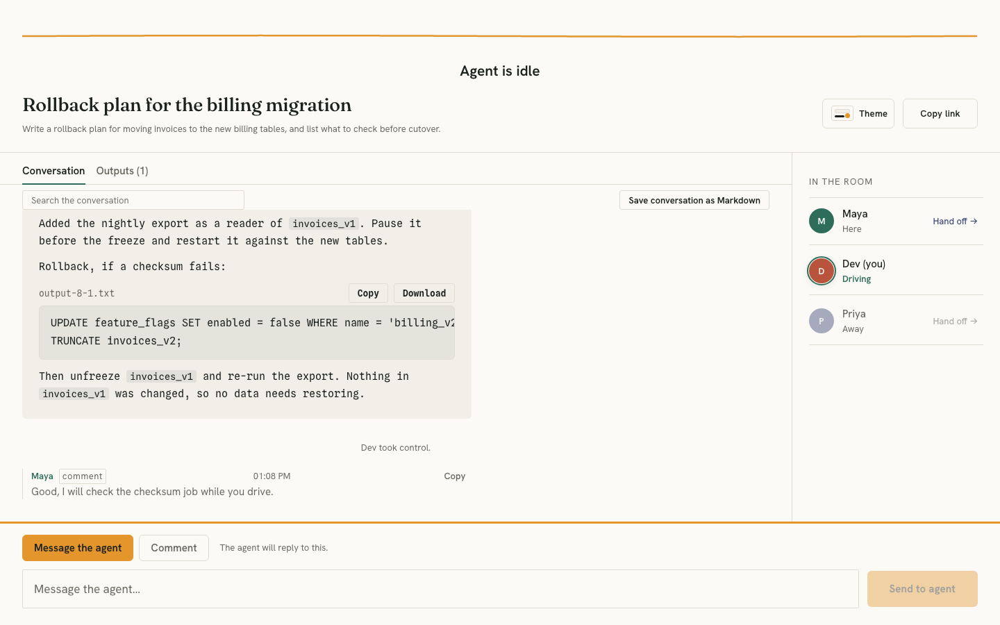

# Multiplayer AI

Multiplayer AI is a room where several people watch and steer one AI agent together: one shared transcript, one agent, and one person steering at a time. It runs on your own computer with your own model key, and it has no accounts.



*A room, drawn from a recorded sample session.*

## Run it

You need [Node](https://nodejs.org) 22.13 or newer (`node --version` tells you which you have). Nothing else: no database, no account, no file to edit.

```bash
git clone https://github.com/Abhijay-MSD/multiplayer-ai.git
cd multiplayer-ai
npm start
```

Instead of `git clone` you can use **Code > Download ZIP** on the repository's page, unzip it, and run `npm start` in the folder it made.

The first start installs what the app needs and builds the web page. That needs an internet connection and can take a minute; later starts skip it. Then it prints a **sign-in link** and opens it in your browser. The link works once, for 5 minutes; press Enter in the terminal for a new one. It opens **Setup**, where you choose a model provider and paste a key, and then **Start a room**.

Your rooms and your saved key live in a folder on your computer, `.multiplayer-ai` in your home folder (set `MULTIPLAYER_AI_DATA_DIR` to put it somewhere else). Settings can export everything or delete it.

## What it can do

- A room where one person steers one agent and everyone else watches and comments. The agent never sees comments.
- **Files.** The agent can list, read and write text files kept in the room, when the host allows it. People in the room can open, copy and download those files, and the controller or the host can attach text files. The controller or the host can stop a running answer with a Stop button, and each answer ends with a quiet line of the model calls, file tool calls and tokens it used (tokens only when the provider reports them). The agent has no shell, no code execution and no web access.
- **Ideas to start from.** The start screen has six ideas; choosing one fills the task box, and nothing is sent until you start the room.
- **Tables and links in replies.** The agent's replies can hold simple tables and `http` or `https` links. Links open in a new tab and show their full address on hover; there are no images and no raw HTML. See [docs/outputs.md](docs/outputs.md).
- **Retry, shortcuts, copy and search.** The controller can send their last message to the agent again (it is a new message, so every limit applies to it, and it is off while the agent is working). Enter, Ctrl+Enter and Cmd+Enter send; Shift+Enter adds a line; Escape closes panels and clears a search. Every message has a Copy button. A search box above the conversation keeps the messages that hold the words.
- **Exports.** Save the conversation as a Markdown file, and download all of a room's files as a zip. Both are made in your browser; see [docs/outputs.md](docs/outputs.md).
- **A room brief.** The host can write a short brief for a room. Everyone in the room can read it, and the agent is given it as the host's instructions.
- **Your rooms.** The host has a page that lists every room on this computer (newest activity first) and can rename, archive, unarchive and delete them. It exists only on the host's own computer, signed in. See [docs/agent-tools.md](docs/agent-tools.md) for what it can and can't do, and what that does and doesn't protect.

## Get a model key

Every reply the agent writes is a request to a model provider, paid for by your key. Setup lets you pick Groq, Gemini, Claude (experimental: not yet tested against the real service), or any service that speaks the OpenAI chat format (including one running on your own computer). [docs/providers.md](docs/providers.md) says where to create a key for each. Providers set their own prices and limits and change them, so read theirs before you start; this project says nothing about what any of them charges. The Claude choice has not been run against the real service yet; press **Test key** first (details in the providers page).

## Share a room

By default only your computer can reach Multiplayer AI. To let people on the same Wi-Fi in, for this run only:

```bash
npm start -- --share=wifi
```

or turn it on in **Settings > Sharing**. Then open a room **on your own computer** (`127.0.0.1` or `localhost`), choose **Host controls**, and give people the link or the QR code. They type a name and they're in. You decide who may take control (locked, ask you first, or free), how many messages guests may send, and who is removed.

The link uses plain `http`. Anyone on the same network who can capture traffic can read what's sent, including the room secret and people's access tokens. Use it only on a network you trust, like your home or your own hotspot. Don't use it on café, hotel, school or office Wi-Fi. Multiplayer AI can't tell what kind of network you're on.

All of it, including what is and isn't tested, is in [docs/sharing.md](docs/sharing.md).

## Privacy

Your rooms and settings stay in a folder on your computer. The only thing that leaves it is what Multiplayer AI sends to the model provider you chose, so the web page loads nothing from any other host, not even fonts. [docs/privacy.md](docs/privacy.md) lists every request and what is stored, and says what has not been verified. It describes what the software does and is not legal advice; no lawyer has reviewed it.

## What it can't do

- **The host's computer has to be on.** Multiplayer AI runs there; when it stops, the rooms are unreachable until it starts again.
- **The host's key pays.** Every reply, including ones that guests ask for, is billed to the key you saved. Guests are limited to 20 messages per room by default.
- **No accounts.** Anyone with a room's link can join under any name that isn't taken. A private room is a room whose link you didn't share.
- **Not over the internet, yet.** Tunnels and public addresses are not supported. Requests that arrive through a proxy or tunnel are refused.

## What has been run, and what has not

**Run:**

- The server tests and the browser tests (Chromium, headless), on macOS with Node 24.
- The server tests, the web build and the first-run flow through the real launcher with a made-up provider, in Linux containers (the official `node` images) on Node 22.13.0, Node 22.23.3 and Node 24. The browser tests were not run on Linux.
- The Docker image: built, started with an empty volume, signed in to, given a reply and a file written by a stand-in provider's tool call, stopped and started again. This was done with Docker Desktop on macOS. See [docs/docker.md](docs/docker.md).
- A scripted set of security probes against the real launcher, on this computer's own address and on its network address with Same Wi-Fi on: forged and rebound `Host`, foreign and missing `Origin`, `Sec-Fetch-Site`, proxy headers on every kind of route, sign-in link reuse, cookie attributes, a room token in another room, the invite flows, host-only routes on the network address, path traversal on the static files, hostile names and text, oversized and malformed bodies, file quotas, a runaway tool loop, and a search of the output, the responses, the data files, an export and a zip for made-up keys and secrets. Nothing was found.
- Each provider's tool-calling format, written to its documentation (or, for Gemini, the library's type definitions), run end to end through the real launcher against stand-ins for the services that refuse a request in the wrong shape.
- The steps in this README, in a fresh copy of the folder, on macOS.

**Not run:**

- Windows, Firefox, Safari, a screen reader, and a real Linux desktop.
- Real phones and other devices on a real network. The sharing tests use this computer's own network address and a container; [docs/sharing.md](docs/sharing.md) has a checklist to run yourself.
- The GitHub Actions workflow in `.github/workflows/ci.yml`. It has not passed yet. Its first run on GitHub passed the install, the build and the server tests, and failed in the browser tests (one Escape test on Linux and macOS, and the transcript scroll-speed check on macOS), so the steps after them never ran. The workflow and the browser tests have been changed since; the changed version has not run on GitHub.
- Any provider's real service with tools: the formats were read from documentation and checked against stand-ins, not run against Groq, Google, Anthropic or an OpenAI-compatible service. The Claude choice is labelled experimental in the app. The optional Supabase storage was not run against a live project (and has no files, no Your rooms and no brief).
- A sign-in link left to expire (the 5-minute rule is tested with a clock stand-in, not waited out).
- The QR code decoding test, on anything but macOS.

[docs/limits.md](docs/limits.md) lists the rate limits and caps.

## If it doesn't start

Each of these has its own message in the terminal.

1. **"Multiplayer AI needs Node 22.13 or newer, and this is Node …"** Install a current Node from [nodejs.org](https://nodejs.org), open a new terminal, and run `npm start` again.
2. **"Installing packages for … failed."** The first start downloads packages from the npm registry. Check your internet connection, then run `npm start` again.
3. **"Building the web app failed."** Read the lines above the message. Deleting `web/dist` and running `npm start` again rebuilds it from scratch.
4. **"port 3737 is busy."** Another copy of Multiplayer AI or another program is using it. Multiplayer AI picks a free port itself and prints the address it is really using, so use that. To choose one, set `MULTIPLAYER_AI_PORT`.
5. **"Multiplayer AI can't use its data folder"** or **"Multiplayer AI can't start; … problem in the environment."** The first says which folder it couldn't use and why; point `MULTIPLAYER_AI_DATA_DIR` at a folder you may write to. The second names the setting that is wrong and what it should be.

If you saved a key and Replies fail, **Settings > Test key** makes one small request and says what went wrong, in words.

## Docker

If you would rather not install Node, from the downloaded folder run:

```bash
docker run --rm -it -p 127.0.0.1:3737:3737 -v multiplayer-ai-data:/data "$(docker build -q .)"
```

That builds the image and starts it (bash, zsh and PowerShell; not cmd.exe). A container can't open your browser, so copy the **sign-in link** it prints into one. Your rooms and your saved key live in the Docker volume `multiplayer-ai-data`; deleting the volume deletes them.

**Publish the port exactly as shown, `127.0.0.1:3737:3737`.** That makes it reachable from your computer only. `-p 3737:3737` (without `127.0.0.1:`) publishes it to your whole network. A container always counts as shared, so only your browser can start rooms and others need a room's link, but you should still choose that on purpose. [docs/docker.md](docs/docker.md) explains it.

## Use it from an MCP client

`server/server.js` is also an MCP server, for clients that start a program and talk to it over standard input and output. It shares the data file and the saved key with the web app, and both can run at once. In the client's configuration:

```json
{
  "mcpServers": {
    "multiplayer-ai": {
      "command": "node",
      "args": ["/absolute/path/to/this/folder/server/server.js"]
    }
  }
}
```

Run `cd server && npm ci` once first. The tools:

| Tool | What it does |
|---|---|
| `create_session` | Creates a session and makes you its controller. Returns session_id, your secret token (shown once) and the share URL. Pass `auto_start: true` to have the agent start on the task at once; without it nothing runs until `step_agent` |
| `join_session` | Joins as a watcher and returns your token plus the transcript. A name already in the room is refused with a suggestion. Pass your token to come back as the same person |
| `get_session` | Participants only: metadata, participants and ordered events |
| `send_directive` | Controller only. Writes a directive, queued for the next agent step |
| `send_comment` | Any participant. Writes a room comment; the agent never sees it |
| `step_agent` | Controller only. Gathers pending directives, calls the model, writes agent_message |
| `take_control` | Take control for yourself (only when nobody is controller or the controller is away), or, as controller, hand it to someone who is here. In a shared room the host decides |
| `set_status` | Controller only. Sets the session to active / paused / done |
| `heartbeat` | Updates your last_seen for presence tracking |
| `leave_session` | Marks you away immediately; keeps your place and token |

Every tool except `create_session` and `join_session` takes your `token`. The server works out who you are from it; a name sent in a request is never trusted.

## How it fits together

```
Web app (browser)  ──REST + live stream──▶  Multiplayer AI server (Node)  ──requests──▶  your model provider
                                                   │
                                                   ▼
                                       a local file (SQLite) in your data folder
```

```
Dockerfile              the image
scripts/                start (the one command), copy check, secrets scan
server/                 the server: tools/, providers/, store/ (the data file), tests in test/
web/                    the web app (React + Vite); web/qa has the browser tests
docs/                   sharing, privacy, providers, limits, Docker, themes, third-party packages, design notes
supabase/               optional hosted storage, frozen; see docs/supabase.md
```

Supabase storage still exists as an option, kept for anyone who wants it. It is not needed, not used by default, and was not checked against a live project in this version; see [docs/supabase.md](docs/supabase.md).

## Tests

Each line starts from the project folder:

```bash
(cd server && npm ci && npm test)                                              # server tests; need no network and no key
(cd web && npm ci && cd qa && npm ci && npx playwright install chromium && npm test)    # browser tests
npm run check:copy                                                             # the copy check
```

[CONTRIBUTING.md](CONTRIBUTING.md) has the rest.

## Security

To report a vulnerability, see [SECURITY.md](SECURITY.md). It says how to report one privately, what to include, and what Multiplayer AI does and doesn't protect.

## License

MIT, see [LICENSE](LICENSE).
